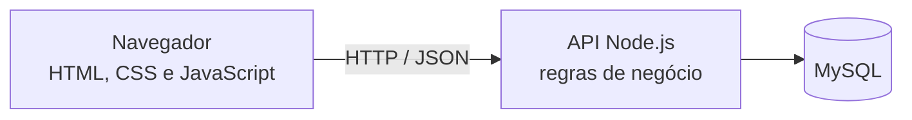
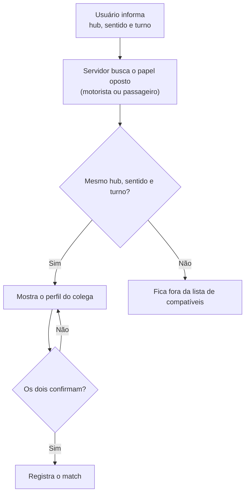
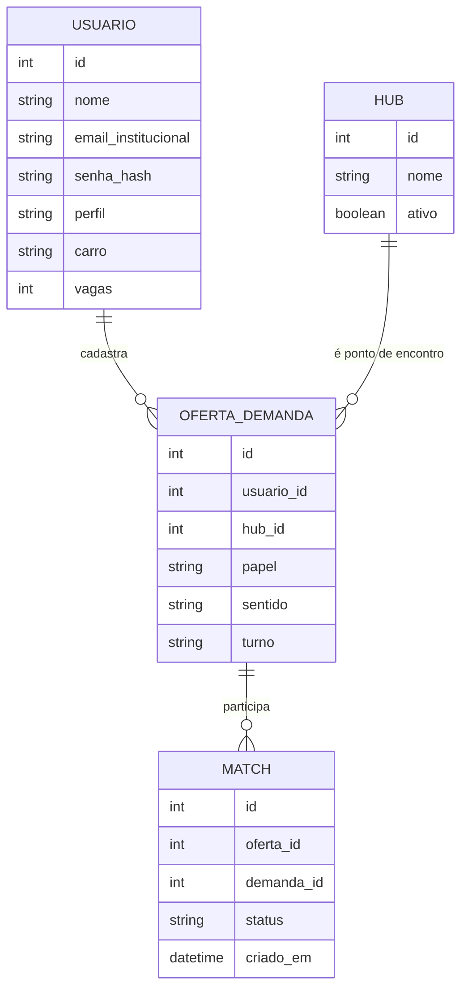

# Arquitetura

## Visão geral

| Camada | Responsabilidade |
| --- | --- |
| **Front-end** | Interface responsiva em HTML, CSS e JavaScript puros, executada no navegador. Não exige instalação em lojas de aplicativos. |
| **Back-end (Node.js)** | Recebe as requisições HTTP, valida a restrição de e-mail institucional e executa o algoritmo de busca de rotas compatíveis. |
| **Banco de dados (MySQL)** | Guarda de forma relacional os usuários, as rotas fixas cadastradas (hubs) e o registro dos matches (caronas confirmadas). |

## Regras de negócio

### Cadastro

O servidor aceita o cadastro apenas se o e-mail pertencer a um destes domínios:

- `aluno.cps.sp.gov.br`
- `fatec.sp.gov.br`

A validação precisa acontecer **no servidor**. A validação feita no navegador serve só para dar retorno rápido ao usuário.

### Match

Uma oferta (motorista) e uma demanda (passageiro) são compatíveis quando têm o mesmo **hub** e o mesmo **horário** (turno). No protótipo, o **sentido** (ida ou volta) também faz parte da comparação.

Regras de ocupação:

- Um **passageiro** confirma uma carona por vez, em cada combinação de hub, sentido e turno.
- Um **motorista** confirma passageiros até o limite de vagas que informou.

## Modelo de dados (rascunho para discussão)

As entidades abaixo seguem o que o projeto prevê (usuários, hubs e matches). Os campos são uma proposta e podem mudar.

## Recomendações de segurança

- Guardar a senha apenas como hash (por exemplo, bcrypt ou argon2), nunca em texto puro.
- Validar e-mail, perfil e demais campos no servidor.
- Não registrar dados pessoais em logs.
