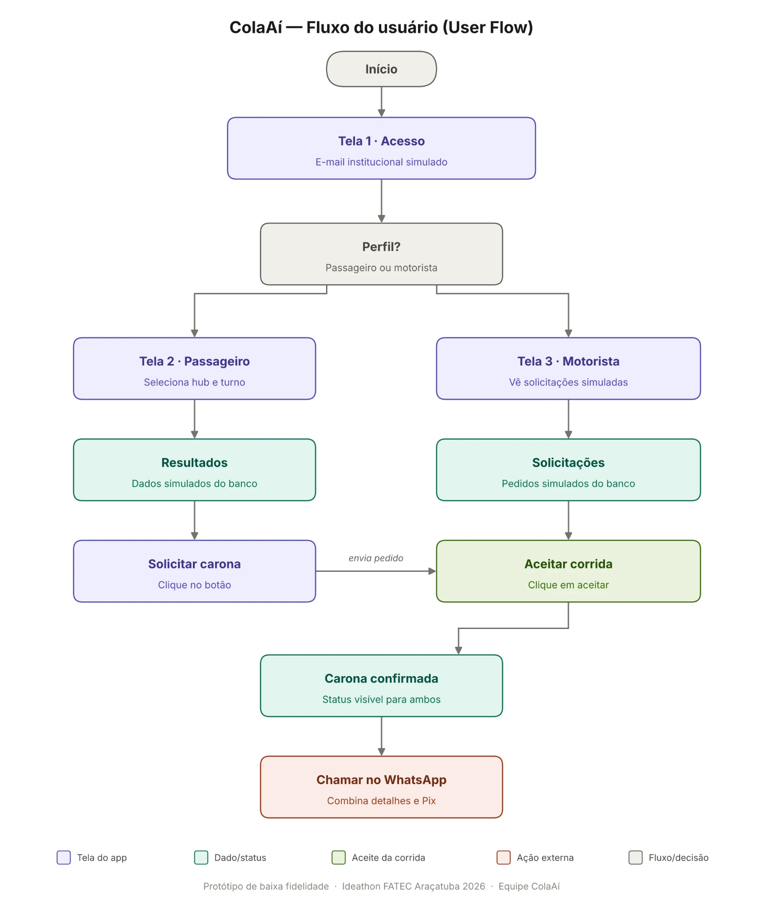
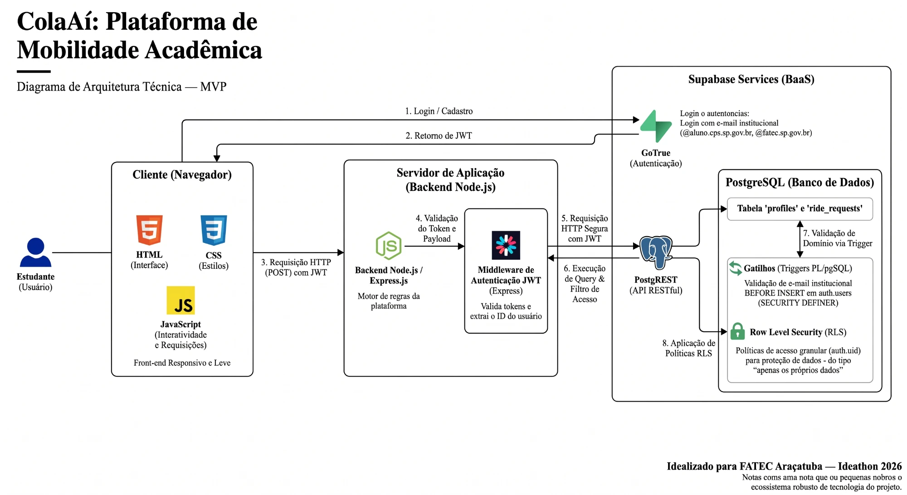
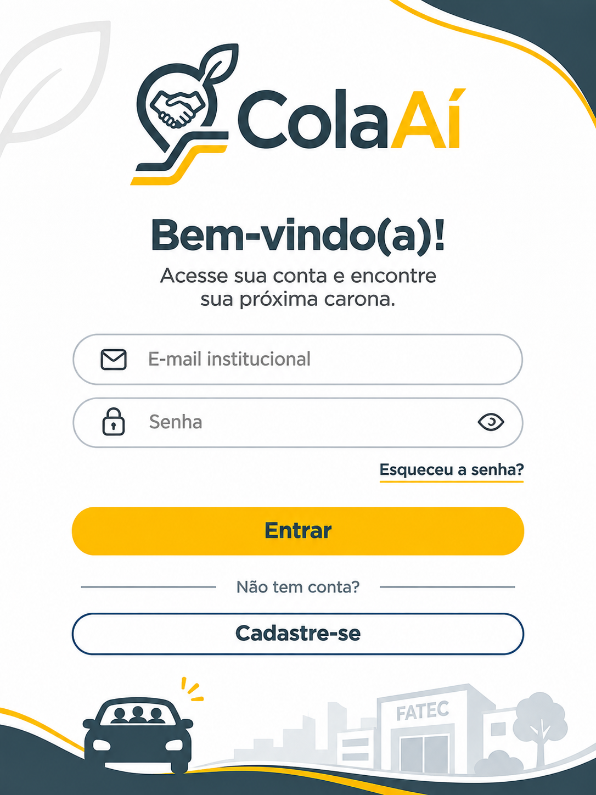
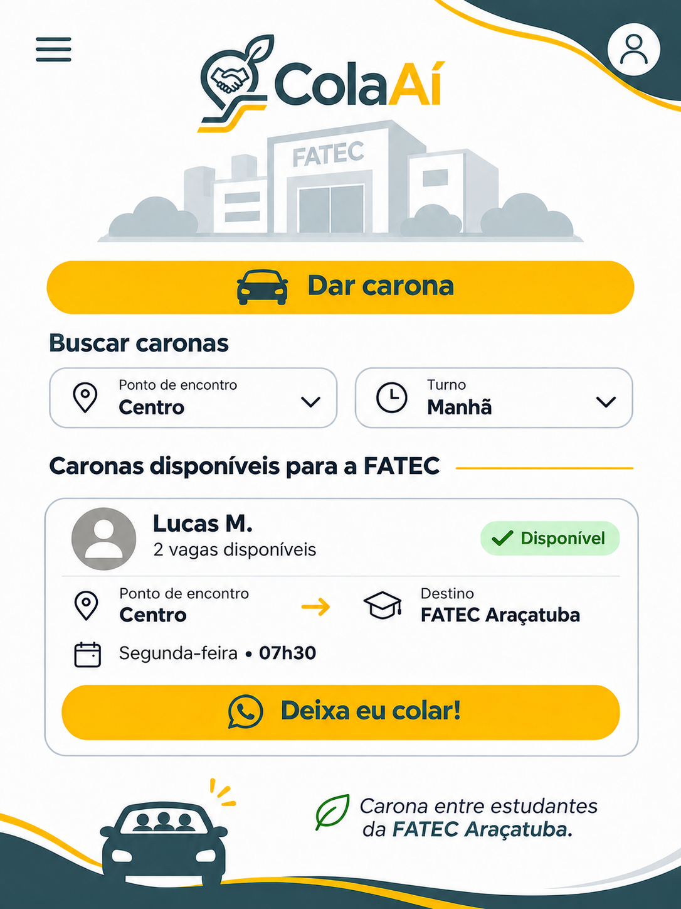
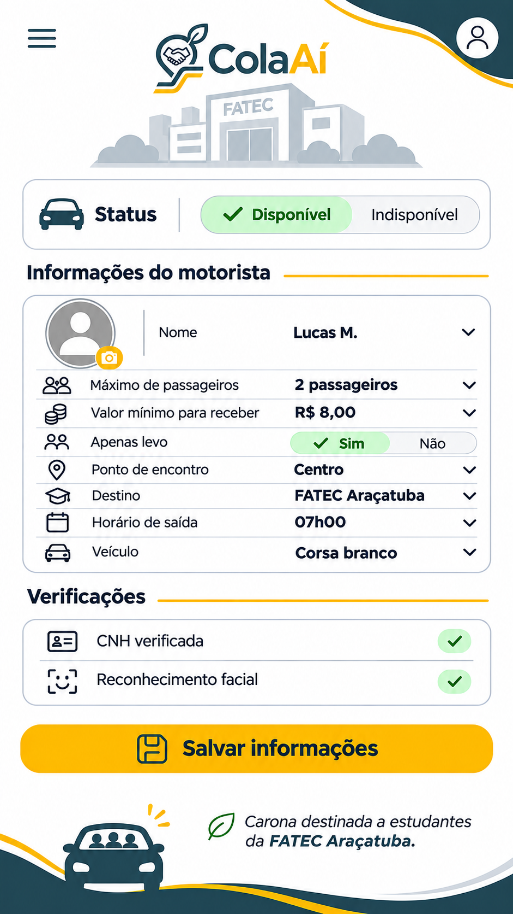

# ColaAí

**Plataforma de mobilidade acadêmica** (**caronas colaborativas**) para estudantes da FATEC Araçatuba, desenvolvida para o **Ideathon FATEC Araçatuba 2026**.

O ColaAí conecta quem tem um lugar sobrando no carro com colegas que vão para o mesmo lugar, no mesmo turno. O ponto de encontro é fixo, o acesso é restrito à comunidade da FATEC e o custo é dividido entre os colegas, sem taxa da plataforma.

> **Status:** projeto em desenvolvimento. Este repositório reúne, por enquanto, a **documentação**, os **wireframes** e o **vídeo de apresentação do protótipo**. O código da aplicação ainda não foi publicado aqui — veja Como rodar e Próximos passos.

## O problema

- **Custo alto para quem vai de ônibus.** A tarifa do transporte coletivo de Araçatuba é de R$ 5,30 por viagem. Considerando que 2 viagens por dia em 20 dias úteis, são R$ 212 por mês para o aluno sem benefício integral.
- **Pouca cobertura e muita espera.** O acesso ao campus (Av. Prestes Maia) tem pouca cobertura direta para bairros distantes. As baldeações no Terminal Central geram esperas de 30 a 60 minutos nas linhas 126, 121 e 108, difíceis de encaixar nos horários de aula.
- **Carros com assentos vazios.** O Canvas do Problema estima uma média de 1,3 passageiro por veículo entre os carros de estudantes. Ausentando uma rede que organize essas caronas com segurança.

Quem mais sofre são os alunos de ADS, Gestão Empresarial e Engenharia Química que moram em bairros distantes, têm entre 17 e 30 anos e não têm carro próprio.

## A solução

- **Comunidade fechada.** O cadastro só aceita e-mails institucionais (`@aluno.cps.sp.gov.br` e `@fatec.sp.gov.br`), e essa regra é aplicada dentro do banco de dados, para não poder ser contornada.
- **Pontos fixos de encontro (hubs).** Centro, Shopping e FATEC, sem desvios longos. Em primeira mão, o foco é a FATEC.
- **Rateio amigável.** O custo é combinado entre os colegas (por exemplo, via pix). A plataforma não processa pagamentos e não cobra taxa.
- **Contato direto pelo WhatsApp** depois que o motorista aceita a carona.

## Como funciona



1. A pessoa entra com o e-mail institucional e escolhe o perfil: **passageiro** ou **motorista**.
2. O **passageiro** escolhe o hub e o turno, vê as caronas disponíveis e clica em **"Deixa eu colar!"**.
3. O **motorista** vê os pedidos recebidos e **aceita** o que quiser.
4. Com a carona confirmada, os dois combinam os detalhes e o Pix pelo **WhatsApp**.

## Arquitetura



| Camada | Tecnologia | Papel |
| --- | --- | --- |
| Interface | HTML, CSS e JavaScript | Padrões da web: rápido, leve e compatível com qualquer navegador ou dispositivo |
| Servidor | Node.js com Express | Regras de negócio e verificação do token (JWT) antes de qualquer acesso aos dados |
| Banco e autenticação | Supabase (PostgreSQL, GoTrue e PostgREST) | Guarda os dados, emite os tokens de login e expõe a API de dados |

**Segurança em camadas:**

- **Validação do e-mail no banco:** um gatilho (`BEFORE INSERT` em `auth.users`) consulta a tabela `allowed_email_domains` e cancela o cadastro se o domínio não for permitido.
- **Row Level Security (RLS):** cada pessoa só lê e altera os **próprios dados**, mesmo que alguém chame a API de dados diretamente.
- **Chaves protegidas:** o servidor não usa a chave `service_role`, que ignora a RLS. Ele repassa o token do usuário ao banco.

Os detalhes estão na [Síntese Técnica](docs/03-arquitetura/sintese-tecnica-arquitetura-e-seguranca.pdf).

## Protótipo

O protótipo de baixa fidelidade tem três telas:

| Acesso | Passageiro | Motorista |
| :---: | :---: | :---: |
|  |  |  |

Há também um [vídeo de apresentação do projeto](docs/05-prototipo/video/apresentacao-colaai.mp4).

## Limitações da primeira versão

Para o Ideathon, o protótipo respeita os limites definidos nas restrições técnicas do projeto: os dados exibidos são simulados e vêm do banco, e a interação do usuário se resume a um clique no botão que abre o WhatsApp. Ficam fora, de propósito:

- rastreamento por GPS em tempo real e mapas interativos;
- pagamento dentro do app;
- validação automática de CNH e checagem de antecedentes;
- cálculo de desvios e rotas porta a porta.

## Impacto

- **Social:** economia direta para os alunos, mais pontualidade nas aulas e uma comunidade acadêmica mais unida.
- **Ambiental:** menos carros com um único ocupante nas ruas de Araçatuba, o que reduz a emissão de gases de efeito estufa (CO₂).

## Como rodar

### Hoje (fase de documentação)

Este repositório ainda não contém o código da aplicação — apenas documentação, wireframes e o vídeo de apresentação. Para explorar o projeto agora:

1. Clone o repositório: `git clone <url-do-repositório>`.
2. Leia a documentação em [`docs/`](#documentação), começando por `docs/01-visao-geral`.
3. Veja as telas do protótipo e assista ao vídeo de apresentação em `docs/05-prototipo`.

### Quando o código for publicado (planejado)

A stack prevista é Node.js/Express no servidor e Supabase (PostgreSQL, GoTrue, PostgREST) no banco e na autenticação. O fluxo esperado de instalação será:

```bash
git clone <url-do-repositório>
cd colaai
npm install

# configurar variáveis de ambiente
cp .env.example .env
# preencher SUPABASE_URL, SUPABASE_ANON_KEY e demais chaves do projeto

npm run dev
```

Esta seção será atualizada com instruções definitivas assim que o código for publicado no repositório.

## Próximos passos

- Ativar os demais hubs (Centro e Shopping), além da FATEC.
- Avaliar rastreamento por GPS e mapas interativos para localizar motoristas e passageiros.
- Explorar uma integração de pagamento assistido (ex.: Pix), sem a plataforma assumir custódia do dinheiro.
- Automatizar a validação de CNH e a checagem de antecedentes, possivelmente via parceria com um serviço externo.
- Implementar cálculo de desvios e rotas porta a porta.
- Testar o fluxo do MVP com usuários reais da comunidade FATEC e ajustar com base no feedback.
- Publicar um ambiente de homologação para demonstração contínua do projeto.

## Documentação

| Pasta | Conteúdo |
| --- | --- |
| [`docs/01-visao-geral`](docs/01-visao-geral/documentacao-detalhada.pdf) | Documentação técnica e de negócio |
| [`docs/02-problema`](docs/02-problema/canvas-do-problema.pdf) | Canvas do Problema, com as evidências de Araçatuba |
| [`docs/03-arquitetura`](docs/03-arquitetura/) | Diagrama, síntese técnica de arquitetura e segurança e pesquisa sobre o Supabase |
| [`docs/04-restricoes`](docs/04-restricoes/restricoes-tecnicas.pdf) | O que fica de fora do protótipo |
| [`docs/05-prototipo`](docs/05-prototipo/) | Fluxo do usuário, wireframes e vídeo |
